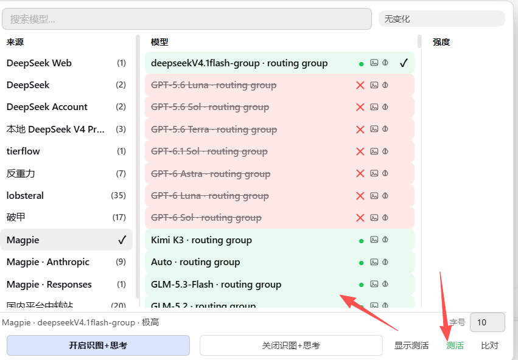
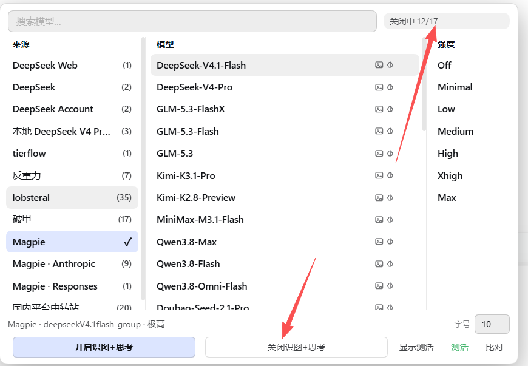
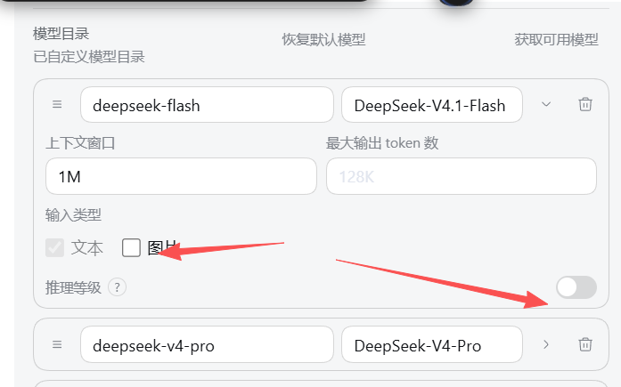
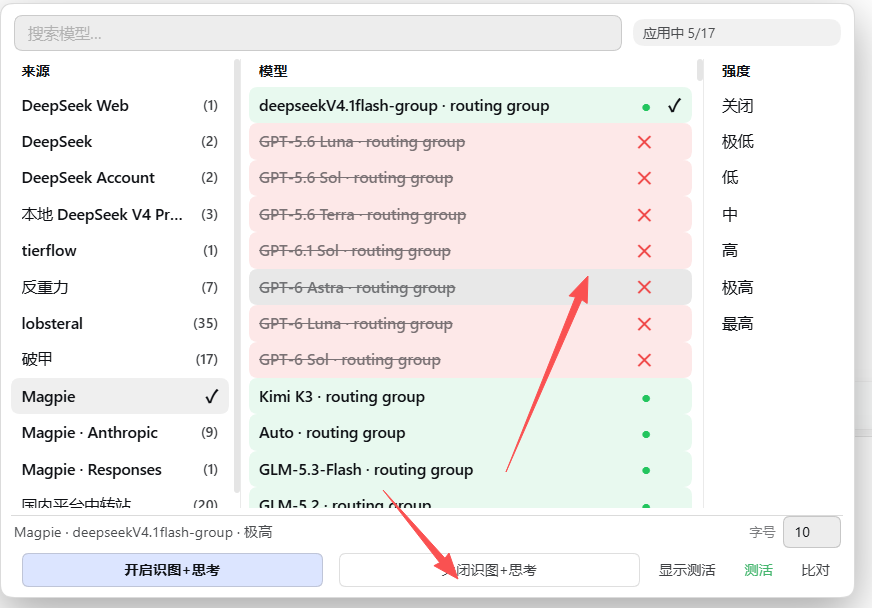

# dsh-model-fold

> **功能描述**：三级级联模型面板（来源 → 模型 → 思考强度），支持识图与思考强度一键开关、能力图标，以及逐模型真实测活并把结果持久化保存。适配 DSH 内核 0.2.2-rc.1。
>
> **English**: Three-column cascade model picker (provider to model to reasoning effort) with one-click image and reasoning switches, capability icons, and real per-model availability probes whose results persist across restarts. Adapts DSH kernel 0.2.2-rc.1.


**给 DSH 的模型选择器换成「来源 / 模型 / 强度」三级级联面板。** 不再一条长列表翻到底，也不再打开官方模型菜单。

**A three-column cascade model picker for DeepSeek Harness (DSH): provider → model → reasoning effort, with one-click capability switches and real per-model availability probes.**



## 这次大更新做了什么

| 能力 | 说明 |
|---|---|
| **三级级联面板** | 左列来源、中列模型、右列强度，同一浮层并排展示，互不遮盖；点强度直接切换模型 + 档位 |
| **识图 / 思考强度一键开关** | 「开启识图+思考」给全部模型补 `image` 与完整七档 `reasoningEfforts`；「关闭识图+思考」移除 `image`、把 `reasoningEfforts` 置 `false`，不需要逐个模型手点 |
| **模型能力图标** | 模型名后显示黑白图标：图片 = 图片设置已打开；大脑 = 思考强度已打开。只代表设置状态，不代表模型真实能力 |
| **逐模型真实测活** | 「测活」对当前来源每个模型发一条 1-token 真实请求：绿色 ● 可用、红色 ✕ 不可用；状态栏实时显示进度 |
| **测活结果持久化** | 结果写入 `~/.dsh/model-fold-probe.json`（`DSH_HOME` 可覆盖），关面板、重启 DSH 后仍在；重测自动覆盖 |
| **显示 / 隐藏测活结果** | 「显示测活」开关控制绿 ●/红 ✕ 的显示；关闭只隐藏，不删除记录 |
| **紧凑布局** | 最宽 640px（`min(92vw, 640px)`，窄屏按 92vw 自适应收窄）、三列 grid、两行 footer；字号支持 8–15 手动输入 |

## 截图

| 测活结果 | 关闭识图 + 思考 |
|---|---|
|  |  |

| 官方设置里的对应开关 | 关闭后图标消失 |
|---|---|
|  |  |

## 安装

```bash
# 仅适用于非 desktop profile（如 web）；desktop profile 请按下方说明手改 package.json
dsh plugin add dsh-model-fold
```

桌面端（desktop profile）由 Electron 独占管理，CLI 会拒绝直接安装；请把 `dsh-model-fold` 加进 `~/.dsh/profiles/desktop/package.json` 的 `dependencies` 与 `dsh.profile.bundles`，再执行 `pnpm install`，最后**彻底退出并重启 DSH**。

## 使用

1. 点输入框右下角的模型胶囊，打开三级面板。
2. 左列选来源 → 中列选模型 → 右列选思考强度。
3. 底部：
   - **开启识图+思考**：给所有模型打开图片输入与完整思考档位；
   - **关闭识图+思考**：关闭图片输入与思考档位；
   - **显示测活**：显示/隐藏上次测活结果；
   - **测活**：对当前来源逐模型发真实请求（会消耗额度）；
   - **比对**：只比对来源返回的模型清单，不逐个测活；
   - **字号**：8–15，手动输入。

## 测活说明

- 走宿主侧 `POST /plugin/dsh-model-fold/probe`，支持 `openai-completions` / `openai-responses` / `anthropic-messages`；
- 每个模型发一条 1-token 的 `ping` 请求：`openai-completions` / `anthropic-messages` 用 `max_tokens: 1`（前者另带 `stream: false`），`openai-responses` 则把 `input` 设为 `ping` 并带 `max_output_tokens: 1`（没有 `max_tokens` 字段）；**2xx 不等于可用**——状态码过了还要看正文，正文含上游错误信息（请求负载过高 / overloaded / 限流 / 额度不足 / invalid api key 等）会标为 `OK_BODY_ERROR` 并按不可用计（黑名单式判定，不裸匹配 `error` 单词、不要求 `choices` 非空，避免假红）；
- key 由宿主按权威度**自动解析**，**用户不需要手工配置环境变量**：候选顺序 = ① 凭据库：宿主凭据服务的 `resolve(apiKeyEnv)` 在前；直读 `~/.dsh/.credentials.yaml` 的 `refs` 段**仅是宿主凭据服务不可用时的兜底**，不是无条件的第三来源；→ ② 面板 / 请求内传入的 `apiKey`（仅 provider 显式配了 `apiKey` 时存在；常态为空）→ ③ `process.env`（`apiKeyEnv` 指定）兜底；注意凭据服务返回的、来源标记为环境变量（`source` 含 `env`）的值**排在 ② 之后**才加入候选，避免旧环境变量把真 key 顶掉；三处全空时记为 `none` 且**不发任何请求**（直接回 `code` 为 `NO_CREDENTIAL`，避免把「插件没拿到 key」显示成「你的 key 被拒绝」）；
- 遇 **401 / 403**（以及响应体带 key 关键字的 400）会**自动换下一把候选 key 重试**，其它状态码（含上游 502、网络错误）不重试；因此**同一个模型最多可能发出 4 次上游请求（4 次额度）**，不是恒定 1 次；失败原因里的 `keySource` 会标明实际用的是哪一把（凭据库 / 请求 / 环境变量），面板悬停可见 `· key:<来源>`；
- 候选 key 含 HTTP 头不允许的字符（码点 > 0xFF，Node 抛 `ERR_INVALID_CHAR`）同样按该候选失败处理，还有下一把就继续换；全部候选耗尽才算该模型不可用；
- 结果保存到 `~/.dsh/model-fold-probe.json`（`DSH_HOME` 可覆盖；请求体上限 16 KB、结果集上限 1 MB，超限保存会失败，localStorage 仍留副本），客户端 localStorage 兜底；文件内 `version` 为 **2**，读到版本不匹配的旧快照会整体作废并重建（升级后不会继续显示旧的假绿点）；
- 模型多的来源（如 Magpie 290 个）需要几分钟；一般每个模型消耗一次极短请求的额度，401/403 换 key 重试时会略多。
- **红叉不等于插件坏了**：修好 key 后可用数仍可能只是「部分变绿」。自称「所有账号都被限制器拦下」的 503、「所有候选账号均已限额或禁用」的 429，都来自网关账号池限流（响应里带恢复时间），额度恢复后自行变绿，**不要据此删模型**；只有上游明确报模型不存在 / 无访问权限、或反复无响应的那些，才是模型本身不可用。

> 图标只表示**设置是否打开**，不代表模型真实能力；真实可用性以「测活」结果为准。

## 兼容

- 需 DSH ≥ 0.1.7-rc.1（0.x 内核线；本版在 desktop profile 实测可用，web 同为 0.x 内核）
- Node.js ≥ 18
- 宿主侧需要 `webServer` 服务（DSH 默认提供）

## 开发

```bash
node --check lib/client.js
node --check lib/index.js
```

客户端改动：`Ctrl+Shift+R` 刷新；宿主改动：彻底退出 DSH 再启动。

## License

MIT
